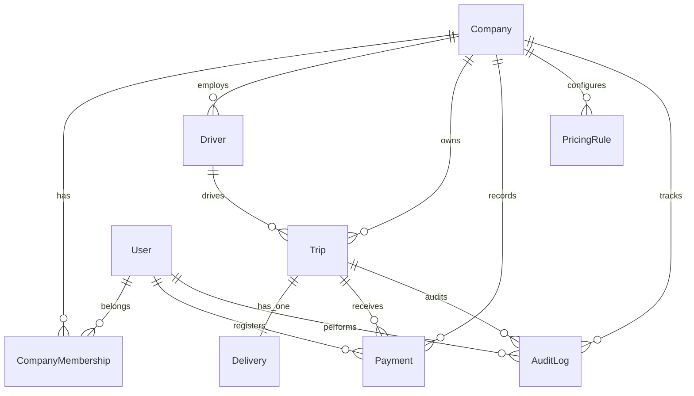

# دليل البنية المعمارية وتصميم النظام (System Architecture)
## نظام المجد لإدارة التوصيل والمشاوير — المرحلة الثانية Full-Stack

تم تصميم وهندسة النظام ليكون نظاماً سحابياً متكاملاً، آمناً، يدعم تعدد المستأجرين (Multi-Tenant Architecture)، ويلتزم بأعلى معايير الأمان المالي والتشغيلي.

---

### 1. المخطط المعماري العام (High-Level Architecture)

```
[ React + Vite Client (RTL Arabic) ]
                │
                │ HTTPS / REST API + JWT Bearer Token + X-Company-Id
                ▼
[ Express.js + TypeScript Application Server (Port 4000) ]
  ├── Security & Policy Layer: Helmet, CORS, Rate Limiters, Cookie Parser
  ├── Context & Tenant Guards: requireAuth, requireCompanyScope, requireRole
  ├── Modules & Business Logic:
  │     ├── Auth & Users (Argon2/Bcrypt, Session/Tokens)
  │     ├── Companies & Memberships (RBAC)
  │     ├── Drivers (Soft Delete / Safe Archival)
  │     ├── Trips & Deliveries (Independent lifecycles)
  │     ├── Payments (Idempotency Key, Decimal Arithmetic)
  │     ├── Pricing Engine (Company overrides + Historical Snapshots)
  │     ├── Reports & Analytics (Database-level Aggregation)
  │     └── AI Operations Layer (OpenAI Function/Tool Calling)
  │
  ├── Data Access Layer: Prisma ORM v6
  └── Persistence: PostgreSQL 17 Relational Database (Port 5434)
```

---

### 2. مخطط قاعدة البيانات العلائقية (Relational Database Schema)

صُممت قاعدة البيانات في PostgreSQL باستخدام Prisma مع علاقات Foreign Keys وفهارس مركبة (Compound Indexes) لتحقيق أقصى درجات الأداء وعزل البيانات:



#### الجداول والحقول المحورية:

1. **الشركات `companies`**:
   - `id`: UUID (Primary Key).
   - `name`: اسم الشركة (افتراضياً "المجد هوم للمفروشات"، مع إمكانية تعدد الشركات).
   - `phone`, `email`, `crNumber`, `taxNumber`, `city`, `address`, `logo`.
   - `defaultCurrency`: العملة المعتمدة (افتراضياً `SAR`).
   - `isActive`: حالة الشركة.

2. **المستخدمون `users`**:
   - `id`: UUID.
   - `email`: بريد فريد مشفر ومفهرس.
   - `passwordHash`: مشفر بخوارزمية Bcrypt مع Salt آمن.
   - `systemRole`: دور النظام (`SYSTEM_ADMIN`, `USER`).

3. **عضويات الشركات `company_memberships`**:
   - `userId` + `companyId`: مفتاح مركب فريد (Unique Constraint).
   - `role`: دور العضو داخل الشركة (`COMPANY_ADMIN`, `STAFF`, `VIEWER`).
   - `isActive`: حالة العضوية.

4. **السائقون `drivers`**:
   - `companyId`: معزول لكل شركة.
   - `name`, `phone`, `vehicleType`, `isActive`.
   - **الحذف الآمن**: لا يُسمح بالحذف الصلب لسائق لديه مشاوير سابقة؛ بل يتم التعطيل التلقائي (`isActive: false`) للحفاظ على السجلات المالية والتاريخية.

5. **المشاوير `trips`**:
   - `companyId`, `driverId`.
   - `tripNumber`: رقم فريد تسلسلي لكل شركة (مثل `TRP-1001`).
   - `orderNumber`, `customerName`, `customerPhone`, `deliveryAddress`.
   - `tripDate`, `tripTime`, `durationMinutes`.
   - `cost`: Decimal لحفظ القيمة المالية بدقة متناهية.
   - `appliedPricingSnapshot`: لقطة JSON لتسعيرة الشركة المطبقة لحظة إنشاء الرحلة (لضمان ثبات السعر التاريخي حتى لو غيّرت الشركة تسعيرتها لاحقاً).
   - `status`: حالة المشوار التشغيلية (`NEW`, `IN_PROGRESS`, `COMPLETED`, `CANCELLED`).

6. **التوصيل `deliveries`**:
   - علاقة `1:1` مع المشوار `tripId`.
   - `status`: حالة استلام العميل (`PENDING`, `DELIVERED`, `FAILED`, `RETURNED`).
   - `actualDeliveryDate`, `actualDeliveryTime`, `recipientName`.
   - `pendingReason`, `nextDeliveryDate`, `failureReason`, `returnReason`, `deliveryNotes`.

7. **المدفوعات `payments`**:
   - `companyId`, `tripId`.
   - `amount`: Decimal.
   - `paymentMethod`: `CASH`, `BANK_TRANSFER`, `CARD`, `CREDIT`, `OTHER`.
   - `idempotencyKey`: مفتاح فريد لمنع تكرار تسجيل الدفعة عند تكرار إرسال الطلب (Network Retry / Double Click).
   - `recordedById`: المستخدم الذي سجل العملية.

8. **إعدادات التسعير `pricing_rules`**:
   - شرائح الدقائق والأسعار القابلة للتخصيص لكل شركة: `tier1MaxMinutes`, `tier1Price`, `tier2MaxMinutes`, `tier2Price`, `tier3MaxMinutes`, `tier3Price`, `extraHourRate`.

9. **سجلات التدقيق `audit_logs`**:
   - تتبع كامل لجميع العمليات الحساسة: نوع العملية، الكيان المتأثر، معرف المستخدم، والبيانات المعدلة خالية تماماً من كلمات المرور أو الأسرار.

---

### 3. آليات عزل بيانات الشركات (Multi-Tenant Isolation)

تم تطبيق عزل صارم على مستوى الخادم وقاعدة البيانات عبر وسيط `requireCompanyScope`:
1. **التحقق من الهوية**: لا يُقبل أي طلب بدون JWT صالح ومفكك الشفرة.
2. **استخراج سياق الشركة**: يتم قراءة `X-Company-Id` من ترويسة الطلب.
3. **التحقق من العضوية**: يقوم الخادم بفحص جدول `CompanyMembership` للتأكد من أن المستخدم ينتمي بالفعل لهذه الشركة وبحالة نشطة.
4. **تطبيق النطاق الإلزامي (Mandatory Scoping)**:
   - كل استعلام قراءة أو كتابة يتضمن تلقائياً شرط `{ companyId }`.
   - محاولة ربط مشوار بسائق من شركة أخرى تُرفض بـ `400 Bad Request`.
   - محاولة قراءة أو تعديل سجل لا ينتمي للشركة النشطة تُرفض بـ `403 Forbidden` أو `404 Not Found`.
5. **مستقل تماماً في التقارير والذكاء الاصطناعي**: أدوات الـ AI تستلم `companyId` المعتمد من سياق الجلسة، ولا يمكن للنموذج تجاوزه.

---

### 4. خوارزمية التسعير والحسابات المالية (Pricing & Financial Engine)

#### القواعد الافتراضية المعتمدة:
| الشريحة الزمنية | التكلفة بالريال |
| :--- | :--- |
| من 1 إلى أقل من 20 دقيقة (19 دقيقة) | 20 ر.س |
| من 20 إلى أقل من 30 دقيقة (29 دقيقة) | 30 ر.س |
| من 30 إلى 60 دقيقة شاملة | 50 ر.س |
| أكثر من 60 دقيقة | 50 ر.س إضافية لكل ساعة أو جزء منها |

#### أمثلة وحالات الحدود المعتمدة والمختبرة:
- 10 دقائق = 20 ر.س
- 19 دقيقة = 20 ر.س
- 20 دقيقة = 30 ر.س
- 29 دقيقة = 30 ر.س
- 30 دقيقة = 50 ر.س
- 60 دقيقة = 50 ر.س
- 61 دقيقة = 100 ر.س
- 120 دقيقة = 100 ر.س
- 121 دقيقة = 150 ر.س

#### الحساب المالي للمدفوعات:
$$\text{المبلغ المستحق المتبقي} = \text{إجمالي تكلفة المشوار} - \sum(\text{الدفعات المسجلة})$$
- يتم التحقق من أن قيمة أي دفعة جديدة لا تتجاوز المبلغ المتبقي، ويتم رفض الدفعات السالبة أو الصفرية فوراً عبر Zod ومتحكم المدفوعات.
- حالات الدفع المعتمدة: `غير مدفوع (UNPAID)`، `مدفوع جزئياً (PARTIAL)`، `مدفوع بالكامل (PAID)`.

---

### 5. طبقة الذكاء الاصطناعي (OpenAI Tool Calling Layer)

تعتمد طبقة الذكاء الاصطناعي على استدعاء الدوال الحتمي (Deterministic Tool Calling) دون إعطاء النموذج أي صلاحية اتصال مباشر بقاعدة البيانات أو توليد كود SQL:

1. **الأدوات المتاحة للنموذج**:
   - `get_trip_summary`: ملخص المشاوير ونسب الإنجاز.
   - `get_driver_performance`: مقارنة أداء وتكاليف السائقين.
   - `get_delivery_status_report`: توزيع حالات تسليم الطلبات للعملاء.
   - `get_financial_summary`: ملخص الإيرادات والمبالغ المسددة والمتبقية.
   - `list_undelivered_trips`: قائمة المشاوير المعلقة أو المتعذرة أو المرتجعة.

2. **الضوابط الأمنية**:
   - جميع الأدوات تعمل للقراءة فقط (`Read-Only`).
   - لا يستطيع الذكاء الاصطناعي حذف بيانات أو تعديل أسعار أو تسجيل دفعات.
   - يتم إرسال `companyId` برمجياً من جلسة المستخدم ولا يُسمح للنموذج بتمرير أو تغيير معرف الشركة.
   - في حال عدم تفعيل مفتاح `OPENAI_API_KEY`، يعمل النظام بأكمله بكفاءة 100% ويعرض المساعد رسالة توضيحية للمستخدم.
